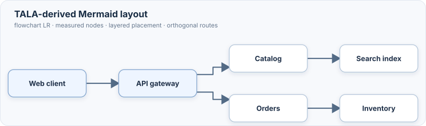
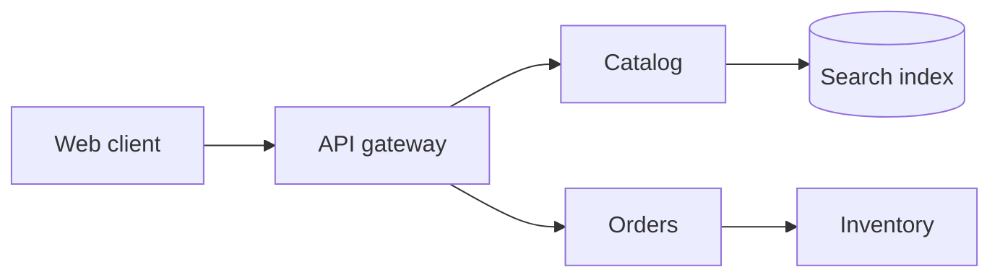

# Mermaid TALA Layout

An experimental TypeScript translation of the TALA layout pipeline from D2,
available as a standalone library and as a Mermaid 12 flowchart layout loader.



Try the [interactive playground](https://crowecawcaw.github.io/mermaid-layout-tala/) to edit Mermaid flowcharts and compare TALA with Mermaid's ELK and Dagre layouts. It includes ten selectable examples, including nested cloud architecture.

The architecture examples use flowchart subgraphs. Mermaid's `architecture-beta` diagrams still use Mermaid's native renderer.

## Install

For standalone use, Mermaid is not required:

```sh
npm install mermaid-layout-tala
```

```ts
import { layoutGraph } from 'mermaid-layout-tala/core';

const result = layoutGraph(
  [{ id: 'a', width: 80, height: 60 }, { id: 'b', width: 80, height: 60 }],
  [{ id: 'ab', from: 'a', to: 'b' }],
  { direction: 'TB' },
);
```

For Mermaid integration, install both packages:

```sh
npm install mermaid mermaid-layout-tala
```

Register the layout loader before rendering diagrams:

```ts
import mermaid from 'mermaid';
import talaLayouts from 'mermaid-layout-tala';

mermaid.registerLayoutLoaders(talaLayouts);
mermaid.initialize({
  startOnLoad: true,
  layout: 'tala',
  flowchart: { htmlLabels: false },
});
```

Then write a normal Mermaid flowchart:



## Scope

The native TypeScript implementation supports measured flowchart nodes, all four
directions (`TB`, `BT`, `LR`, `RL`), nested subgraph containers with local directions,
connected components, parallel links, cycles, and self loops. Rectangle obstacle
routing prevents routes from crossing unrelated node interiors. Mermaid clips
endpoints to its rendered shapes. Measured edge labels reserve layer space and
are placed away from nodes, container titles, and previously placed labels. Layout
runs the default seeds `[1, 2, 3]` using a Go-compatible random stream and selects
the result by upstream penalty, then area, with later seeds winning exact ties.

The public layout now runs the translated upstream TALA pipeline. The pinned
full-layout corpus matches all 545 cases, including nested groups, loops, parallel
edges and all four directions. This corpus is a useful baseline, not proof of
parity for every graph or all D2 features. See the [parity matrix](./test/UPSTREAM-PARITY.md).

The synchronous `layoutGraph(nodes, edges, options)` API is also available as
`layoutFlowchart` for compatibility. Nodes
can specify `parentId`, `isGroup`, `direction`, `shape`, measured labels,
icon placement, font size, class metadata, fixed positions, `nearId` relationships, and D2
styles, including `fontSize`, `threeDee`, and `multiple`. The convenience fields
`fontSize`, `is3D`, and `isMultiple` take precedence over their style equivalents. Edges can specify measured
labels, arrow flags, arrowhead types, fill, and `sourceArrowheadStyle` or
`targetArrowheadStyle` records. Explicit arrowhead fill flags take precedence
over style fill values. Nodes can request fixed dimensions with `fixedSize: true`, or set `desiredWidth` and `desiredHeight` independently. Invalid parent references and cycles
are rejected. The legacy `nodeSpacing`, `rankSpacing`, `orderingPasses`, and
`containerPadding` options are accepted for compatibility; upstream TALA uses
its own spacing and ordering policies. As in upstream, edges used to define a
sequence of step-shaped nodes are consumed by layout and omitted from the result.

For a D2 near key that names a nested object, use `nearPath` with its local ID
components, for example `['group', 'item']`; paths resolve from the root and
are case-insensitive as in D2.

By default the API preserves node and edge input order, matching D2. Set
`inputOrder: 'canonical'` for results independent of input array order. Set an
edge's `d2Index` to its original D2 edge index when reproducing a D2 graph; if
omitted, it counts earlier equivalent edges as the D2 compiler does. Explicit
indices accept safe integers or signed 64-bit `bigint` values.
When D2 objects in different containers share a local name, give each node a
unique API `id` and supply its original local name as `d2Id`.
Leaving `direction` unset also preserves D2's unspecified-direction behavior;
pass `direction: 'TB'` when a top-to-bottom direction is required.

For a D2 sequence lifeline, `d2LifelineEndId(actorId)` constructs its synthetic
destination ID from the actor's local D2 ID (`d2Id`, when supplied). Supply that
ID as `to` and set both arrow flags to `false`;
the returned edge's destination is the actor, as in the upstream layout result.
Set `rootSequence: true` when the D2 root itself is a sequence diagram.
For D2 subgraphs, `rootLevel` preserves the original root nesting level; set
`isGrid: true` on objects with D2 grid rows or columns.

Use `routeEdges(nodes, edges, selectedIds, options)` to reroute selected edges
without changing node positions. Nodes supply center coordinates `x` and
`y`; unselected edges must supply existing `points`. The function returns new
selected-edge records and leaves the input graph and unselected routes intact.
For example:

```ts
import { routeEdges } from 'mermaid-layout-tala/core';

const routed = routeEdges(
  [
    { id: 'a', x: 40, y: 30, width: 80, height: 60 },
    { id: 'b', x: 240, y: 30, width: 80, height: 60 },
  ],
  [{ id: 'ab', from: 'a', to: 'b' }],
  ['ab'],
);
```

Both `layoutFlowchart` and `routeEdges` accept a `context` option. Use
`withCancel()` to create a context and cancellation function, or implement
`TalaContext` to observe cancellation from shared state. Calls are synchronous,
so a cancellation callback on the same JavaScript event loop cannot run until
the call returns. `withCancel(parent)` inherits the parent's values and
cancellation.

Use `setTalaSeeds([1, 2, 3])` to configure defaults, or pass `seeds` in the direct
API's options. Seeds accept safe integer numbers or signed 64-bit `bigint`
values. Up to 64 entries and 16 unique seeds are allowed; duplicates are removed
in authored order. `getTalaSeeds()` returns an independent copy. `evaluateLayout()`
returns a score for a public layout result. Seed selection uses the translated
upstream graph evaluator. Some Mermaid shapes have matching upstream shape
policies; arrowhead labels are available in the direct flowchart input model.

## Development

```sh
npm ci
npm run build
npm test
```

`npm run test:parity` compares complete layouts and standalone rerouting against
pinned Go fixtures. It currently reports 545/545 layouts, 32/32 layout failures,
90/90 rerouting cases, and 5/5 rerouting failures matching. Additional upstream features and graph shapes still need
differential coverage.

Run the playground with `npm run demo -- --port 4173`, then open
<http://127.0.0.1:4173/>. Build the GitHub Pages site with
`npm run build:playground`. A push to `main` deploys it through the Pages workflow.
The translated rank tests and their upstream
coverage mapping are in [`test/`](./test/UPSTREAM-RANK-COVERAGE.md).

## Releases

Releases use [Release Please](https://github.com/googleapis/release-please-action)
and Conventional Commits. Commits to `main` update a release PR with the next
version and changelog; merging that PR creates a GitHub release and publishes
the package to npm after the build and tests pass.

- `fix:` creates a patch release.
- `feat:` creates a minor release.
- Add `!` after the type (for example, `feat!:`) for a breaking major release.

## Credits and license

This layout builds on TALA, D2's graph layout engine from Terrastruct. Thanks
to the upstream TALA contributors—Alexander Wang, Gavin Nishizawa, and Júlio
César Batista—for the original work. This is an independent TypeScript port.
The upstream source is pinned to
[D2 commit `bf337903`](https://github.com/d2lang/d2/tree/bf33790338b9854cb2a34418e69c17f9abf8de4b/d2layouts/d2talalayout).

This project is distributed under the Mozilla Public License 2.0. See
[LICENSE](./LICENSE), [NOTICE.md](./NOTICE.md), and
[UPSTREAM-AUTHORS.md](./UPSTREAM-AUTHORS.md) for license and attribution details.
