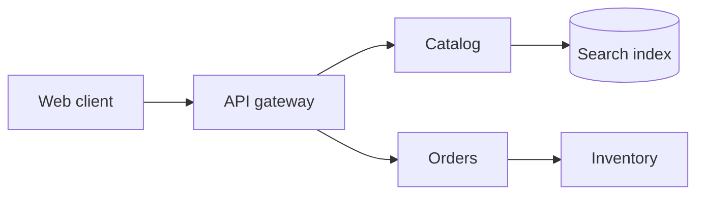

# Mermaid TALA Layout

An experimental TypeScript layout loader for Mermaid 12 flowcharts. It ports
TALA's weighted DAG rank assignment from D2 and adds layer ordering, spacing,
component placement, and orthogonal edge routes.


Try the [interactive playground](https://crowecawcaw.github.io/mermaid-layout-tala/) to edit Mermaid flowcharts and compare TALA with Mermaid's ELK and Dagre layouts. It includes ten selectable examples, including nested cloud architecture, and controls for TALA's node and layer spacing.

The architecture examples use flowchart subgraphs. Mermaid's `architecture-beta` diagrams still use Mermaid's native renderer.

## Install

```sh
npm install mermaid mermaid-layout-tala
```

Register the layout loader before rendering diagrams:

```ts
import mermaid from 'mermaid';
import talaLayouts from 'mermaid-layout-tala';

mermaid.registerLayoutLoaders(talaLayouts);
mermaid.initialize({
  startOnLoad: true,
  layout: 'tala',
  flowchart: { htmlLabels: false },
});
```

Then write a normal Mermaid flowchart:



## Scope

The native TypeScript implementation supports measured flowchart nodes, all four
directions (`TB`, `BT`, `LR`, `RL`), nested subgraph containers with local directions,
connected components, parallel links, cycles, and self loops. Rectangle obstacle
routing prevents routes from crossing unrelated node interiors. Mermaid clips
endpoints to its rendered shapes. Measured edge labels reserve layer space and
are placed away from nodes, container titles, and previously placed labels. Layout
runs the default seeds `[1, 2, 3]` using a Go-compatible random stream and selects
the result by upstream penalty, then area, with later seeds winning exact ties.

**Full upstream TALA parity is not yet achieved.** The weighted DAG ranker has translated upstream correctness coverage, and
hierarchy ordering/alignment matches 120 Go-generated differential fixtures. Container layout, routing, and
label placement are native implementations with functional regression tests;
they do not reproduce upstream coordinates. General placement/refinement,
compound alignment, upstream packing, complete label optimization, and the remaining upstream placement/routing stages are still unported. See the [parity matrix](./test/UPSTREAM-PARITY.md).

The synchronous `layoutFlowchart(nodes, edges, options)` API is preserved. Nodes
can specify `parentId`, `isGroup`, `direction`, `labelWidth`, and `labelHeight`;
edges can specify measured `labelWidth` and `labelHeight`. Nodes can opt out of upstream edge-density resizing with `fixedSize: true`.
Container dimensions
are minimum sizes and expand to fit their children. `containerPadding` defaults
to 24. Invalid parent references and parent cycles are rejected. The router
bounds each fallback search to 250,000 grid points and throws if that budget is
exceeded or no route exists. Labels may move away from their route when crowded.

Use `setTalaSeeds([1, 2, 3])` to configure defaults, or pass `seeds` in the direct
API's options. Seeds accept safe integer numbers or signed 64-bit `bigint`
values. Up to 64 entries and 16 unique seeds are allowed; duplicates are removed
in authored order. `getTalaSeeds()` returns an independent copy. `evaluateLayout()`
returns the penalty and area used for selection. Scoring covers measured node
and edge labels and rectangle geometry; icons and arrowhead labels remain outside
the adapter's input model.

## Development

```sh
npm ci
npm run build
npm test
```

`npm run test:parity` compares complete layouts against 36 pinned Go fixtures.
It currently reports 12/36 matching and exits nonzero for the remaining
differences; this is a full-parity acceptance check, separate from the passing
regression and stage-differential suite.

Run the playground with `npm run demo -- --port 4173`, then open
<http://127.0.0.1:4173/>. Build the GitHub Pages site with
`npm run build:playground`. A push to `main` deploys it through the Pages workflow.
The translated rank tests and their upstream
coverage mapping are in [`test/`](./test/UPSTREAM-RANK-COVERAGE.md).

## Releases

Releases use [Release Please](https://github.com/googleapis/release-please-action)
and Conventional Commits. Commits to `main` update a release PR with the next
version and changelog; merging that PR creates a GitHub release and publishes
the package to npm after the build and tests pass.

- `fix:` creates a patch release.
- `feat:` creates a minor release.
- Add `!` after the type (for example, `feat!:`) for a breaking major release.

## Credits and license

This layout builds on TALA, D2's graph layout engine from Terrastruct. Thanks
to the upstream TALA contributors—Alexander Wang, Gavin Nishizawa, and Júlio
César Batista—for the original work. This is an independent TypeScript port.
The upstream source is pinned to
[D2 commit `bf337903`](https://github.com/d2lang/d2/tree/bf33790338b9854cb2a34418e69c17f9abf8de4b/d2layouts/d2talalayout).

This project is distributed under the Mozilla Public License 2.0. See
[LICENSE](./LICENSE), [NOTICE.md](./NOTICE.md), and
[UPSTREAM-AUTHORS.md](./UPSTREAM-AUTHORS.md) for license and attribution details.
